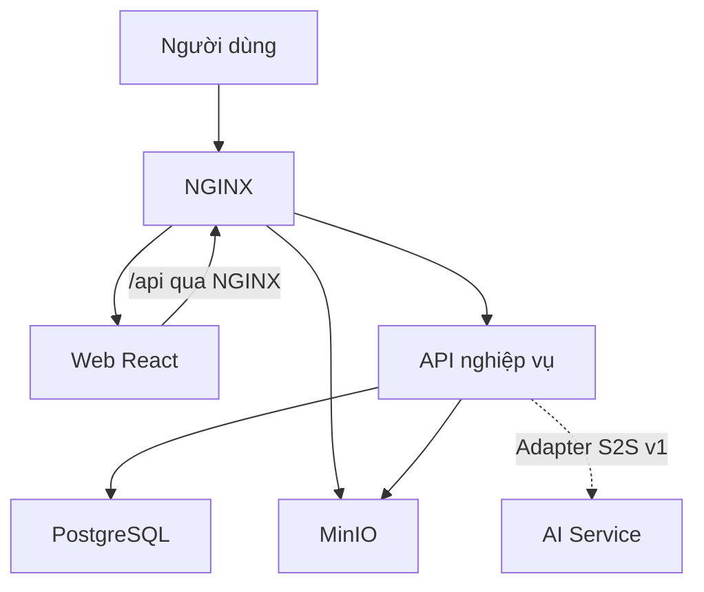

# Tài liệu chung SupportFlow AI

Cập nhật ngày 05/11/2026. Dùng bộ tài liệu này để phối hợp giữa bốn kho mã và chuẩn bị nghiệm thu MVP. Phạm vi cấp cao do chủ dự án quyết định gồm Identity và Ticketing. Đặc tả chi tiết và tiêu chí nghiệm thu trong bộ này dành cho nhóm rà soát.

| Nội dung | Dùng khi |
| --- | --- |
| [Phạm vi, yêu cầu và luồng MVP](mvp.md) | Lập kế hoạch, chuẩn bị demo và xây dựng kịch bản nghiệm thu |
| [Đối chiếu API và quyền truy cập](api-and-access.md) | Tích hợp giao diện với backend, kiểm thử phân quyền và xử lý sai lệch hợp đồng |
| [Ranh giới trách nhiệm](../infra/repository-boundaries.md) | Xác định kho sở hữu thay đổi và các bên phải phối hợp |
| [Bản phát hành và lưu trữ](../release-and-storage.md) | Chuẩn bị môi trường, ảnh theo digest, migration và kiểm chứng triển khai |

## Kiến trúc hiện trạng

Frontend React tổ chức theo tính năng và gọi backend ASP.NET Core qua `/api`. Backend là một ứng dụng nguyên khối chia mô-đun theo Clean Architecture, sở hữu quyền nghiệp vụ và dữ liệu. Backend truy cập PostgreSQL, cấp quyền tải tệp qua MinIO và lưu metadata của tệp đã xác nhận. AI Service FastAPI có hợp đồng phân loại nội bộ v1 và hai bộ cung cấp `rule`/`noop`. Backend có adapter HTTP cho hợp đồng này. Luồng gọi AI khi xử lý ticket và giao diện duyệt gợi ý chưa được nối đầu cuối.

Ở cấu hình toàn hệ thống, NGINX định tuyến tới Web, API và đầu tải tệp được cấu hình. Worker và công cụ Database có điểm vào riêng do backend sở hữu. Mũi tên nét đứt biểu diễn khả năng tích hợp đã có adapter. [Hướng dẫn triển khai](../../deploy/README.md) · [Cấu hình release](../../deploy/compose.release.yml)

## Mốc nguồn đã đối chiếu

| Kho | `main` tại thời điểm rà soát | Nguồn do kho sở hữu |
| --- | --- | --- |
| `ai-it-service-desk` | [`bf38ef9`](https://github.com/supportflow-ai/ai-it-service-desk/commit/bf38ef903f46f6ea21f80da44c11d437391a9efb) | [Hợp đồng HTTP](https://github.com/supportflow-ai/ai-it-service-desk/blob/main/contracts/backend/openapi-baseline.json), [ADR](https://github.com/supportflow-ai/ai-it-service-desk/tree/main/docs/adr), schema và migration |
| `ai-it-service-desk-web` | [`ade7af4`](https://github.com/supportflow-ai/ai-it-service-desk-web/commit/ade7af4e1b88e7834c8d9b225f68eb7ebd75f9fe) | [Nguồn snapshot backend](https://github.com/supportflow-ai/ai-it-service-desk-web/blob/main/tests/contracts/backend-source.json), UI, điều hướng và kiểm tra phản hồi |
| `ai-service` | [`7c09102`](https://github.com/supportflow-ai/ai-service/commit/7c0910298c35150cb28ed2a71605b8c4e03a3938) | [Bản ghim hợp đồng phân loại](https://github.com/supportflow-ai/ai-service/blob/main/contract.lock.json), inference và đánh giá AI |
| `supportflow-ai-infra` | [`77ba2db`](https://github.com/supportflow-ai/supportflow-ai-infra/commit/77ba2db53c6971adc182a0de60dab607109ed163) | [Triển khai](../../deploy/README.md), gateway, lưu trữ và kiểm thử khói |

Khi cập nhật một giao diện giữa các kho, sửa hợp đồng và kiểm thử ở kho sở hữu trước. Ghim phiên bản nguồn ở kho tiêu thụ, sau đó cập nhật phần tóm tắt và mốc đối chiếu ở đây. Các đặc tả backend có mốc cũ vẫn phục vụ truy vết và thảo luận chính sách. [Danh mục tài liệu backend](https://github.com/supportflow-ai/ai-it-service-desk/blob/main/docs/README.md) · [Quyết định nghiệp vụ còn mở](https://github.com/supportflow-ai/ai-it-service-desk/blob/main/docs/architecture/pending-business-decisions.md)

## Phạm vi rà soát

Nội dung tổng hợp từ bản đặc tả hệ thống ngày 05/11/2026 và năm bản Markdown P0 về phạm vi, yêu cầu, ca sử dụng, OpenAPI và phân quyền. Các nhận định hiện trạng dựa trên mã, cấu hình và hợp đồng ở bốn commit trên. Nội dung riêng trong gói hợp đồng P0 v0.2 và v0.3 còn chờ đối chiếu. Khi nghiệm thu, ghi riêng SHA, môi trường và kết quả chạy kiểm thử thực tế.
