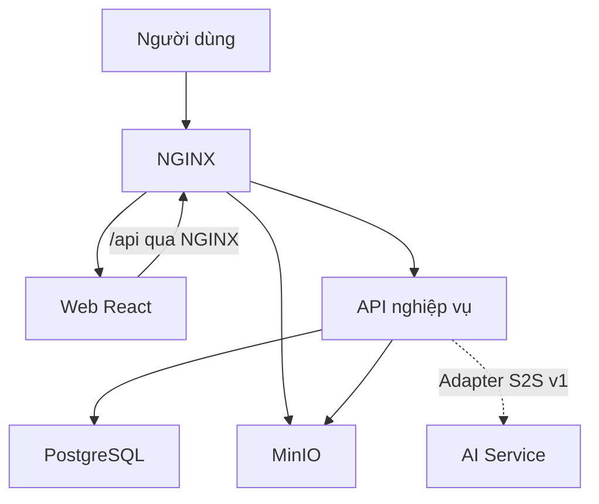

# Tài liệu chung SupportFlow AI

Cập nhật ngày 05/11/2026. Dùng bộ tài liệu này để phối hợp giữa bốn kho mã và chuẩn bị nghiệm thu MVP. Phạm vi cấp cao do chủ dự án quyết định gồm Identity và Ticketing. Đặc tả chi tiết và tiêu chí nghiệm thu trong bộ này dành cho nhóm rà soát.

| Nội dung | Dùng khi |
| --- | --- |
| [Phạm vi, yêu cầu và luồng MVP](mvp.md) | Lập kế hoạch, chuẩn bị demo và xây dựng kịch bản nghiệm thu |
| [Đối chiếu API và quyền truy cập](api-and-access.md) | Tích hợp giao diện với backend, kiểm thử phân quyền và xử lý sai lệch hợp đồng |
| [Ranh giới trách nhiệm](../infra/repository-boundaries.md) | Xác định kho sở hữu thay đổi và các bên phải phối hợp |
| [Bản phát hành và lưu trữ](../release-and-storage.md) | Chuẩn bị môi trường, ảnh theo digest, migration và kiểm chứng triển khai |

## Kiến trúc hiện trạng

Frontend React tổ chức theo tính năng và gọi backend ASP.NET Core qua `/api`. Backend là một ứng dụng nguyên khối chia mô-đun theo Clean Architecture, sở hữu quyền nghiệp vụ và dữ liệu. Backend truy cập PostgreSQL, cấp quyền tải tệp qua MinIO và lưu metadata của tệp đã xác nhận. AI Service FastAPI có hợp đồng phân loại nội bộ v1 và hai bộ cung cấp `rule`/`noop`. Backend có adapter HTTP cho hợp đồng này. Luồng gọi AI khi xử lý ticket và giao diện duyệt gợi ý chưa được nối đầu cuối.

Ở cấu hình toàn hệ thống, NGINX định tuyến tới Web, API và đầu tải tệp được cấu hình. Worker và công cụ Database có điểm vào riêng do backend sở hữu. Mũi tên nét đứt biểu diễn khả năng tích hợp đã có adapter. [Hướng dẫn triển khai](../../deploy/README.md) · [Cấu hình release](../../deploy/compose.release.yml)

## Mốc nguồn đã đối chiếu

| Kho | `main` tại thời điểm rà soát | Nguồn do kho sở hữu |
| --- | --- | --- |
| `ai-it-service-desk` | [`bf38ef9`](https://github.com/supportflow-ai/ai-it-service-desk/commit/bf38ef903f46f6ea21f80da44c11d437391a9efb) | [Hợp đồng HTTP](https://github.com/supportflow-ai/ai-it-service-desk/blob/main/contracts/backend/openapi-baseline.json), [ADR](https://github.com/supportflow-ai/ai-it-service-desk/tree/main/docs/adr), schema và migration |
| `ai-it-service-desk-web` | [`ade7af4`](https://github.com/supportflow-ai/ai-it-service-desk-web/commit/ade7af4e1b88e7834c8d9b225f68eb7ebd75f9fe) | [Nguồn snapshot backend](https://github.com/supportflow-ai/ai-it-service-desk-web/blob/main/tests/contracts/backend-source.json), UI, điều hướng và kiểm tra phản hồi |
| `ai-service` | [`7c09102`](https://github.com/supportflow-ai/ai-service/commit/7c0910298c35150cb28ed2a71605b8c4e03a3938) | [Bản ghim hợp đồng phân loại](https://github.com/supportflow-ai/ai-service/blob/main/contract.lock.json), inference và đánh giá AI |
| `supportflow-ai-infra` | [`77ba2db`](https://github.com/supportflow-ai/supportflow-ai-infra/commit/77ba2db53c6971adc182a0de60dab607109ed163) | [Triển khai](../../deploy/README.md), gateway, lưu trữ và kiểm thử khói |

Khi cập nhật một giao diện giữa các kho, sửa hợp đồng và kiểm thử ở kho sở hữu trước. Ghim phiên bản nguồn ở kho tiêu thụ, sau đó cập nhật phần tóm tắt và mốc đối chiếu ở đây. Các đặc tả backend có mốc cũ vẫn phục vụ truy vết và thảo luận chính sách. [Danh mục tài liệu backend](https://github.com/supportflow-ai/ai-it-service-desk/blob/main/docs/README.md) · [Quyết định nghiệp vụ còn mở](https://github.com/supportflow-ai/ai-it-service-desk/blob/main/docs/architecture/pending-business-decisions.md)

## Rà soát lại ngày 13/11/2026

Bảng mốc ở trên giữ nguyên làm mốc của bản chụp 05/11/2026. Lần rà soát này đối chiếu các khẳng định kiểm chứng được bằng mã và hợp đồng với trạng thái hiện tại của các kho.

| Kho | Mốc hiện tại | Thay đổi kể từ bản chụp (theo tiêu đề commit) |
| --- | --- | --- |
| `ai-it-service-desk` | `main` `97ab047`, `dev` `07ce07a` | B1-PR3 (#64): Agent chỉ đọc phiếu của nhóm hỗ trợ đang hoạt động mà mình thuộc hoặc phiếu được phân công trực tiếp, Admin đọc toàn hệ thống ([ADR-016](https://github.com/supportflow-ai/ai-it-service-desk/blob/main/docs/adr/ADR-016-support-team-routing-and-agent-scope.md)); B3 (#65): hạn mức tệp đính kèm theo phiếu, xử lý lock timeout khi xác nhận; đổi cấu trúc thư mục (`Hosts`, `Platform`) và tên công cụ `Migrator` |
| `ai-it-service-desk-web` | `main` `935c2df`, `dev` `386d709` | Làm mới phiên bằng refresh token, quên và đổi mật khẩu bằng OTP, danh mục phòng ban, danh bạ nhân viên và phân công, cột người xử lý ở hàng đợi, trang giới thiệu, chế độ tối; chỉ Requester thấy mục tạo yêu cầu |
| `ai-service` | `main` `c4669a7` | Chia khối Markdown, embedding CPU E5, endpoint `POST /v1/knowledge-indexes:prepare`, stage `embeddings` trong Dockerfile; hợp đồng phân loại v1 không đổi |
| `supportflow-ai-infra` | `main` `cf1cb16` | PostgreSQL chuyển sang pgvector 0.8.1, cấu hình `KnowledgeIndex`, MinIO build từ bản phát hành bảo mật của upstream, đồng bộ Compose với công cụ Migrator |

**Đã kiểm lại và khớp:**

- Hợp đồng AI v1 ở backend và ai-service khớp từng byte (sha256 `ad1d9323…`).
- Mọi đường dẫn và phương thức trong bảng "API và quyền theo thao tác" của [api-and-access.md](api-and-access.md) vẫn có mặt ở backend `dev@07ce07a`.
- AI chưa được nối vào luồng xử lý phiếu: không mã nào ngoài module AIAssistance của backend dùng cổng phân loại, và web chưa có lớp API cho AI.
- Knowledge có API ở backend và giao diện ở web.

**Đã sửa:** phiên bản PostgreSQL đã thống nhất là 17 ngày 2026-11-13 (trước đó stack CI smoke dùng 17 còn local, system, release dùng 16); phạm vi đọc của Agent đã đổi từ B1-PR3; xem phần "Cập nhật sau bản chụp" ở [api-and-access.md](api-and-access.md) và [mvp.md](mvp.md).

**Lệch còn mở, cần phối hợp giữa các kho (không sửa ở đây):**

1. Web ghim snapshot OpenAPI của backend ở `0f189b5` (sha256 `3884d37d…`), còn baseline backend `dev` có hash `c60fa717…`. Không có đường dẫn hay schema mới, nhưng sáu thao tác đổi chi tiết: `POST /api/auth/register`, `/login`, `/refresh`, `/forgot-password`, `/reset-password` và `POST /api/tickets/{id}/attachments/confirm`.
2. Giao diện web chỉ cho Requester vào `/tickets/new`, trong khi API tạo phiếu cho phép Requester, Agent và Admin (policy `RequireRequester`). Chủ dự án xác nhận 2026-11-13: Agent và Admin cũng phải tạo được; việc cần sửa ở web được liệt kê trong `docs/architecture/api-baseline.md` của kho web.
3. Compose truyền `KnowledgeIndex__BearerToken` cho API và Worker, nhưng backend `dev` chưa có cấu hình hay mã tiêu thụ endpoint chỉ mục Knowledge của ai-service. Chủ dự án chốt 2026-11-13: backend sẽ tiêu thụ; kế hoạch ở `docs/architecture/ai-integration-plan.md` của kho backend.

**Chưa kiểm lại:** cột "Ràng buộc chính" chi tiết (mã lỗi, `Location`, revision trong query hay body) và hành vi từng màn hình web; các nội dung này vẫn là bản chụp 05/11/2026. Khi nghiệm thu, ghi riêng SHA, môi trường và kết quả chạy thực tế.

## Phạm vi rà soát

Nội dung tổng hợp từ bản đặc tả hệ thống ngày 05/11/2026 và năm bản Markdown P0 về phạm vi, yêu cầu, ca sử dụng, OpenAPI và phân quyền. Các nhận định hiện trạng dựa trên mã, cấu hình và hợp đồng ở bốn commit trên. Nội dung riêng trong gói hợp đồng P0 v0.2 và v0.3 còn chờ đối chiếu. Khi nghiệm thu, ghi riêng SHA, môi trường và kết quả chạy kiểm thử thực tế.
