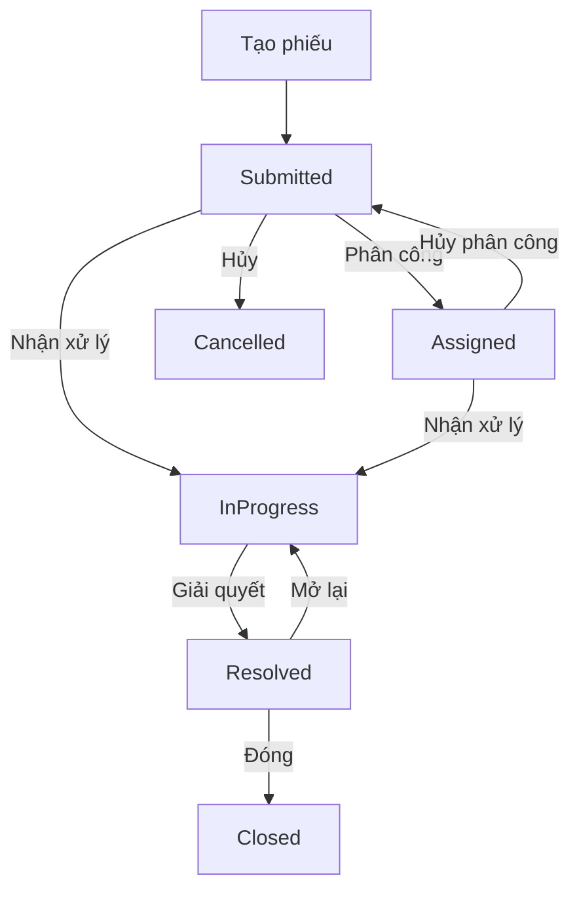

# Phạm vi, yêu cầu và luồng MVP

[Tài liệu chung](README.md) · [API và quyền truy cập](api-and-access.md)

Chủ dự án phê duyệt phạm vi và chọn `main` làm nhánh chuẩn. Phạm vi cấp cao gồm Identity và Ticketing. Các luồng chi tiết dưới đây kết hợp hành vi quan sát được và điều kiện nghiệm thu đề xuất. Chủ dự án quyết định khi cần đổi chính sách hoặc mở rộng phạm vi.

| Nhóm | Quyết định phạm vi | Hiện trạng tại mốc đối chiếu |
| --- | --- | --- |
| Identity | MVP | Backend và Web có đăng ký, đăng nhập, hồ sơ hiện tại và quản lý phiên ở giao diện |
| Ticketing | MVP | Backend và Web có các luồng chính. Cần nghiệm thu phân công, quyền theo trạng thái và tệp trên môi trường demo |
| Knowledge | Cần xem xét riêng | Đã có API, lưu trữ bài viết và giao diện đọc, quản trị theo quyền |
| Phân loại AI, duyệt gợi ý, embedding và RAG | Giai đoạn sau | Có hợp đồng phân loại và adapter. Chưa có luồng ticket đến AI rồi qua người duyệt |
| SLA, thông báo, phân tích và quản trị đầy đủ | Giai đoạn sau | Route quản trị trên Web đang hiển thị trang chưa hỗ trợ |

## Yêu cầu và ca sử dụng

| Ca sử dụng | Người thực hiện | Luồng thành công | Tiêu chí đề xuất để nghiệm thu |
| --- | --- | --- | --- |
| UC-01–03 · Tạo tài khoản, đăng nhập, khôi phục phiên | Khách và người đã đăng nhập | Đăng ký cấp `Requester`. Đăng nhập cấp JWT, Web lấy hồ sơ qua `/api/auth/me` | Thử tự gán quyền cao, đăng nhập sai, token hết hạn và truy cập route staff bằng tài khoản Requester |
| UC-04 · Chọn kỹ thuật viên | Agent, Admin | Lấy danh bạ và chọn một Agent hợp lệ để phân công | Danh bạ từ backend thật có thể đọc được và dùng để phân công |
| UC-05–07 · Tạo, liệt kê và xem chi tiết phiếu | Requester, Agent, Admin | Tạo phiếu ở `Submitted`. Danh sách cá nhân lọc theo người đăng nhập. Chi tiết tuân theo phạm vi đọc | Replay cùng khóa và dữ liệu không nhân đôi phiếu. Đổi dữ liệu cùng khóa trả `409`. Requester khác nhận `404` khi đọc phiếu ngoài phạm vi |
| UC-08 · Sửa phiếu mới | Chủ phiếu, Admin | Cập nhật trường được phép khi phiếu còn `Submitted` | API dùng revision hiện tại. Xác nhận màn hình sửa trước khi đưa vào kịch bản Web |
| UC-09–12 · Hàng đợi và vòng đời phiếu | Agent, Admin hoặc chủ phiếu tùy thao tác | Lọc hàng đợi, phân công, nhận, giải quyết, mở lại, đóng hoặc hủy theo trạng thái | Kiểm tra cả quyền, trạng thái và revision. Gửi hai lệnh cùng revision để xác nhận chỉ một thay đổi thành công |
| UC-13–15 · Bình luận, ghi chú và lịch sử | Người có quyền truy cập phiếu | Bình luận công khai hiển thị trong phạm vi đọc. Ghi chú nội bộ dành cho staff | Dùng token Requester gọi thẳng API để xác nhận không thể ghi hoặc đọc ghi chú nội bộ |
| UC-16 · Đính kèm và tải xuống | Người có quyền truy cập phiếu | Xin quyền tải lên, gửi tệp tới storage, xác nhận với backend rồi tải lại danh sách | Kiểm tra đúng quyền, tệp chỉ hiện sau xác nhận, xác nhận lặp và từ chối truy cập tệp ngoài phạm vi |

Sơ đồ ghi những chuyển trạng thái đã có lệnh tại mốc backend. Sửa thông tin giữ `Submitted`. Phân công ở trạng thái được phép ngoài `Submitted` giữ trạng thái hiện tại. `TicketStatus` còn có giá trị dành cho các luồng khác. [Mô hình Ticket](https://github.com/supportflow-ai/ai-it-service-desk/blob/bf38ef903f46f6ea21f80da44c11d437391a9efb/src/backend/ServiceDesk.Domain/Ticketing/Ticket.cs) · [Mã trạng thái](https://github.com/supportflow-ai/ai-it-service-desk/blob/bf38ef903f46f6ea21f80da44c11d437391a9efb/src/backend/ServiceDesk.Domain/Ticketing/TicketStatus.cs)

## Ghi nhận nghiệm thu

| Lớp | Bằng chứng cần có |
| --- | --- |
| Hợp đồng | Snapshot Web đối chiếu với đúng SHA backend, có kiểm tra schema và phản hồi thực tế cho những luồng tích hợp |
| Phân quyền và tính đồng thời | Kiểm thử trực tiếp với ba vai trò, hai Requester khác nhau và hai yêu cầu ghi cạnh tranh trên PostgreSQL |
| Tệp đính kèm | Kiểm thử từ trình duyệt qua storage thật, gồm lỗi confirm, thử lại confirm và quyền tải xuống |
| Demo | Chạy hành trình đăng ký hoặc đăng nhập, tạo phiếu, phân công, trao đổi và hoàn tất trên cùng môi trường. Ghi SHA, cấu hình và kết quả từng luồng |

Web cần phân biệt đang tải, rỗng, lỗi phiên, thiếu quyền và lỗi kết nối. Với `409`, giữ dữ liệu đã nhập và cho tải lại revision. Nếu tệp đã lên storage nhưng confirm lỗi, cho xác nhận lại grant thay vì gửi lại tệp. Khi xét mở Knowledge, cập nhật quyết định phạm vi và ghi rõ hành vi của các API Knowledge trong môi trường demo.

## Quyết định còn mở

| Chủ đề | Điểm cần chốt |
| --- | --- |
| Quyền Agent và Admin | Giữ phạm vi đọc toàn hệ thống hay giới hạn theo nhóm hoặc phân công. Đồng bộ nút nhận xử lý với chính sách đã chốt |
| Trạng thái và mở lại | Quyết định riêng về Draft/Submit, các trạng thái chờ, thời hạn mở lại và tự đóng |
| Tệp đính kèm | Chốt thời hạn liên kết, quota, quét tệp, lưu giữ và xóa trước khi mở rộng phạm vi phát hành |
| Knowledge | Quyết định phạm vi sản phẩm và cách xử lý các endpoint đã có trong bản demo |

Ghi quyết định, người duyệt và tác động trong nguồn nghiệp vụ ở kho sở hữu. [Bảng quyết định backend](https://github.com/supportflow-ai/ai-it-service-desk/blob/main/docs/architecture/pending-business-decisions.md)
